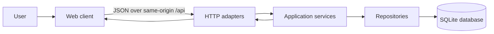

# Technical architecture and design guide

## 1. Purpose and authority

This document defines the implementation architecture for the Income & Expense
Tracker MVP. The product behavior and acceptance criteria in `docs/prd.md` remain
the product contract. This guide resolves technical boundaries and explains how
to preserve that contract in implementation and tests.

The repository currently contains no application implementation or selected
runtime. The design therefore specifies framework-neutral boundaries. A chosen
stack may name the modules differently, but it must preserve the interfaces,
invariants, and dependency direction described here.

## 2. Scope and architectural decisions

### 2.1 MVP boundary

Build a single-user web application backed by one server process and one SQLite
database. The server owns persistence, validation, totals, and category rules.
The browser owns presentation, form state, and early feedback only.

Do not introduce accounts, remote synchronization, background jobs, queues,
caches, multiple currencies, transaction editing, or third-party services in the
MVP. These would add failure modes without supporting the launch scope.

### 2.2 Architecture style

Use a modular monolith with four logical layers:

1. **Web client** — renders the dashboard and captures user intent.
2. **HTTP adapters** — parse JSON and query parameters, invoke one application
   operation, and map its result to the documented HTTP contract.
3. **Application services** — enforce use-case rules and orchestrate database
   work. They contain no framework request or response objects.
4. **Persistence adapters** — execute parameterized SQLite statements and map
   rows to domain records.

Dependencies point inward: HTTP and persistence adapters depend on application
contracts; application services do not depend on UI or HTTP details. Route
handlers must not contain SQL, and UI code must not calculate authoritative
summary totals.



A distributed system is not justified at this scale. Keep client assets and API
same-origin in production so authentication and CORS complexity are not added
before the product requires them.

## 3. Component responsibilities

### 3.1 Web client

The client must:

- load categories, transactions, and the server-computed summary;
- keep amount input as text while the user edits it;
- convert a valid decimal amount to integer cents without binary floating-point
  arithmetic;
- filter category choices to the selected transaction kind;
- disable submission while a create request is in flight;
- preserve entered values after validation or network failure;
- after a successful mutation, refetch the affected server resources rather
  than patching or recomputing authoritative totals locally; and
- render explicit loading, empty, ready, and failure states.

For decimal conversion, accept digits with at most one decimal separator and at
most two fractional digits, normalize the fractional part to two digits, and
combine the digit strings as cents. Reject exponent notation, signs, grouping
separators, and more than two decimal places. Formatting for display occurs only
after integer cents are received from the API.

### 3.2 HTTP adapters

Each adapter must:

- require `application/json` for request bodies;
- reject malformed JSON and unsupported shapes as `VALIDATION_ERROR`;
- allowlist documented fields so ignored client typos cannot silently change
  meaning;
- pass typed input to an application service;
- return the common error envelope from the PRD; and
- avoid returning stack traces, SQL details, filesystem paths, or raw exceptions.

The wire representation of money is always an integer number of cents. For a
predictable contract, the server rejects string values such as `"100"` for
`amountCents`; it does not coerce them. This is one of the alternatives permitted
by PRD edge case EC-4.

### 3.3 Application services

Define one operation per use case, including at least:

- `createTransaction`
- `listTransactions`
- `deleteTransaction`
- `getSummary`
- `listCategories`
- `createCategory`

`createTransaction` owns the atomic validation sequence:

1. Validate the complete command shape and scalar limits.
2. Parse `occurredOn` as a real calendar date using strict `YYYY-MM-DD` syntax.
3. Reject a date after the server's current business date.
4. Load the referenced category.
5. Return `NOT_FOUND` if the category does not exist.
6. Return `CATEGORY_KIND_MISMATCH` if its kind differs from the command kind.
7. Insert the transaction using the category and validated values.
8. Read the created record joined with its category name and return it.

Steps 4–8 run in one database transaction so a concurrent category change cannot
invalidate the check before insertion. Category deletion is not exposed in the
MVP, but the foreign key remains the final integrity boundary.

Validation failures must not write partial data. Expected domain failures use
stable error codes; unexpected failures are logged once at the outer server
boundary and returned as `INTERNAL_ERROR`.

### 3.4 Persistence adapters

Repositories expose operations in domain terms and hide SQL and row-shape
concerns. They must:

- use bound parameters for every external value;
- return an explicit not-found result rather than throwing for absent rows;
- perform writes inside application-controlled transactions;
- join categories when returning transactions so `categoryName` reflects the
  referenced row; and
- use deterministic ordering: `occurred_on DESC, created_at DESC, id DESC` for
  transaction lists and `total_cents DESC, category_id ASC` for equal category
  totals.

The additional tie-breakers do not alter product ordering. They make repeatable
pagination, UI behavior, and tests possible.

## 4. Data model and database lifecycle

The tables, columns, indexes, seed values, and core constraints are defined in
`docs/prd.md`. Implement them through ordered, versioned migrations committed
with the application. Never infer schema state only from table existence.

Every SQLite connection must enable:

```sql
PRAGMA foreign_keys = ON;
PRAGMA busy_timeout = 5000;
```

Use write-ahead logging for the application database to improve read/write
coexistence at single-user scale. Apply migrations before accepting traffic.
Migration failure or an unwritable database is a startup failure; the server must
not replace it with a new empty ledger.

Schema creation and seed insertion must be transactional and idempotent. Seed
categories only when their `(name, kind)` key is absent. Enforce the category key
with case-insensitive comparison after trimming input in the service. The schema
must enforce the documented enum checks, positive amount check, foreign key, and
`ON DELETE RESTRICT` behavior even though the service validates first.

Store:

- `occurred_on` as the user's calendar date, without timezone conversion;
- `created_at` as a server-generated UTC instant in a single canonical ISO-8601
  format; and
- `note` as nullable trimmed text, preserving internal whitespace.

An omitted or all-whitespace note becomes `NULL`. This prevents semantically
empty notes from becoming distinct stored values.

## 5. API and data flow

The endpoints, success payloads, status codes, and error envelope in
`docs/prd.md` are canonical. Do not add a second API shape for the same use case.

The create-expense flow is:

```mermaid
sequenceDiagram
    participant U as User
    participant W as Web client
    participant A as API adapter
    participant S as Transaction service
    participant D as SQLite
    U->>W: Enter amount, expense category, date, optional note
    W->>W: Validate and convert decimal text to cents
    W->>A: POST /api/transactions
    A->>S: createTransaction(command)
    S->>D: Begin; read category
    D-->>S: Category or no row
    S->>S: Validate category kind and date
    S->>D: Insert and read created transaction
    S->>D: Commit
    S-->>A: Created transaction
    A-->>W: 201 JSON
    W->>A: Refetch summary and transaction list
    A-->>W: Server-authoritative state
    W-->>U: Updated ledger and totals
```

A failed refetch after a successful create must not invite an automatic repeat of
the POST. Show that the transaction was accepted but the latest view could not
be loaded, and offer a read retry. This avoids accidental duplicates when the
write succeeded but a later request failed.

The MVP API does not provide idempotency keys. The client-side in-flight guard is
therefore mandatory, but the server and QA must acknowledge that retries after
an ambiguous network failure can create a duplicate. Adding server idempotency
requires a product-level identity and retention contract and is not implied by
this story.

## 6. Validation contract

Apply client validation for speed and repeat every authoritative rule on the
server except decimal-to-cents conversion, because the server receives cents.

| Input | Server rule | Failure |
| --- | --- | --- |
| `kind` | Exact enum `income` or `expense` | `400 VALIDATION_ERROR` |
| `amountCents` | JSON integer, `> 0`, and within the runtime's safe integer and SQLite integer ranges | `400 VALIDATION_ERROR` |
| `categoryId` | Positive integer identifying an existing category | `400 VALIDATION_ERROR` for shape; `404 NOT_FOUND` for absent row |
| `occurredOn` | Strict, real `YYYY-MM-DD` date not after the current business date | `400 VALIDATION_ERROR` |
| `note` | Omitted, `null`, or string no longer than 140 characters after the product-defined count rule | `400 VALIDATION_ERROR` |

Return one deterministic field error at a time. Validate in request-field order,
then perform category existence and kind checks. The `field` member is included
for field-specific validation and omitted for general/internal failures.

Do not rely on permissive runtime date parsing. Parse year, month, and day,
construct a calendar date with a strict date library or equivalent, and verify
that formatting it returns the exact input. This rejects values such as
`2026-02-30` and timestamp strings.

## 7. Error handling and resilience

Use the PRD error codes without framework-specific variants. Map failures at the
HTTP boundary:

- request syntax and field rules to `VALIDATION_ERROR`;
- missing category or transaction rows to `NOT_FOUND`;
- a valid category of the wrong kind to `CATEGORY_KIND_MISMATCH`;
- case-insensitive category uniqueness violations to `DUPLICATE_CATEGORY`; and
- all unclassified failures to `INTERNAL_ERROR`.

Do not expose whether an internal error came from SQLite, disk access, or code.
Log enough structured context to diagnose it, then preserve the public envelope.
Set a bounded request-body size and bounded database wait time. A busy timeout
that expires is an internal service failure, not a validation failure.

On startup, verify the database path, apply migrations, seed categories, and run
a minimal read query before listening. `/api/health` reports liveness without
returning configuration or filesystem details.

## 8. Security and privacy

This MVP has no authentication. Treat it as a local or otherwise trusted
single-user deployment, not an internet-exposed multi-user service. Until an
identity and authorization design exists:

- bind to loopback by default in local deployments;
- serve UI and API from the same origin;
- do not enable wildcard CORS;
- use parameterized SQL exclusively;
- validate all request bodies and query parameters at the boundary;
- do not log request bodies, notes, amounts, category names, or database file
  contents;
- keep the database outside publicly served asset directories; and
- apply least-privilege filesystem permissions to the database and its journal
  files.

If deployment beyond a trusted device is required, authentication, authorization,
transport security, CSRF strategy, backup handling, and per-user data ownership
must be designed before release. Adding only a login screen is insufficient.

## 9. Observability

Emit one structured record per request with timestamp, generated request ID,
method, route template, response status, stable error code when present, and
duration. Propagate the request ID into unexpected-error logs. Do not record full
URLs when query parameters could contain user data.

Emit structured startup events for migration version, seed completion, and
readiness. Never include SQL parameter values or raw transaction/category data.
At MVP scale, logs and the health endpoint are sufficient; metrics infrastructure
is optional. Performance tests still enforce the PRD's summary latency target.

## 10. Compatibility and migrations

Treat the documented JSON field names and error codes as public contracts between
client and server. Additive response fields are safer than renames, but the client
must ignore unknown fields. Do not change the meaning or units of an existing
field.

Database changes use forward-only migrations. Before any destructive migration,
create a separately tested data-copy plan and document rollback or backup
requirements. Migrations must be tested both against an empty database and the
latest previously released schema with representative data.

No legacy implementation exists at the time of this decision, so the initial
migration establishes version 1. Later implementations must not replace migration
history with a fresh schema snapshot.

## 11. Testing strategy and QA contract

Tests must exercise real application paths and real temporary SQLite databases;
do not mock repositories in integration or acceptance coverage.

### 11.1 Developer test layers

- **Unit tests:** decimal-text conversion, strict calendar-date parsing,
  validators, error mapping, and display formatting.
- **Service integration tests:** application services plus repositories against a
  temporary SQLite database with foreign keys enabled.
- **HTTP contract tests:** real routes, JSON parsing, content type, status code,
  response shape, and common error envelope.
- **Browser tests:** user form behavior, preserved values, disabled double-submit,
  success refresh, empty state, and retry state.
- **Migration tests:** empty bootstrap, repeated startup, upgrade from the prior
  schema, seed idempotency, foreign-key enforcement, and unwritable-path failure.
- **Performance tests:** summary response under the PRD threshold with 10,000
  transactions on a documented representative environment.

Each test owns an isolated database file. Freeze or inject the application clock
for date-boundary tests; do not depend on the machine's current date.

### 11.2 Required create-expense coverage

Developer and QA validation for expense creation must include:

1. A valid expense persists integer cents, returns `201`, and appears with its
   category name.
2. Summary expense and balance values update from database rows after creation.
3. Zero, negative, missing, fractional, string, unsafe, and out-of-range cent
   values return `400` and leave row count unchanged.
4. Missing, malformed, impossible, and future dates return `400`; today's date
   succeeds at the configured business-date boundary.
5. Unknown category returns `404`; an income category returns
   `CATEGORY_KIND_MISMATCH`; neither case inserts a row.
6. Notes at the limit succeed; over-limit notes fail; omitted and blank notes
   normalize consistently.
7. Malformed JSON, wrong content type, unknown fields, and wrong scalar types
   produce the documented envelope without internal details.
8. A rapid double click results in one client request while submission is in
   flight.
9. A network/API failure preserves form data and permits a deliberate retry.
10. Database foreign keys and positive-amount checks reject invalid direct
    inserts, proving defense in depth.

### 11.3 Delivery checklist

A developer change is ready for QA only when:

- migrations bootstrap a new database and preserve an existing one;
- all PRD invariants are enforced at their assigned boundaries;
- client and server tests cover the changed use case and its failure paths;
- logs contain no financial or note content;
- API examples match executable contract tests; and
- the full test suite passes from a clean checkout.

QA should report both the failed product criterion and the boundary that allowed
it: client validation, HTTP contract, service rule, persistence constraint, or
state refresh. This makes integrity defects distinguishable from presentation
defects.

## 12. Assumptions, open decisions, and risks

The following decisions are not specified by the product documents and must not
be guessed silently during implementation:

- **Runtime and frameworks:** no client or server stack has been selected. Choose
  one stack before implementation and record the decision without changing the
  contracts in this guide.
- **Business-date timezone:** date validation requires a definition of "today."
  Use UTC as the temporary server default for deterministic development and
  tests, but product ownership must choose the user-facing timezone before a
  non-local release.
- **Currency and locale:** storage is intentionally currency-agnostic integer
  cents, while the MVP is single-currency. Product ownership must select the
  display currency and locale before release; neither belongs on each transaction
  until multi-currency is designed.
- **Deployment and backup:** this guide assumes a trusted single-user device.
  Hosting on a shared or public server changes the security and data-recovery
  requirements and needs a separate architecture decision.
- **Note length counting:** specify whether the 140-character limit counts Unicode
  code points or user-perceived characters. Until decided, use Unicode code
  points consistently on client and server and test non-ASCII input.

The highest current risk is not scale; it is silent ledger corruption through
inconsistent money conversion, date handling, or category-kind validation. Keep
those rules centralized, integer-based, and covered through the real database.
